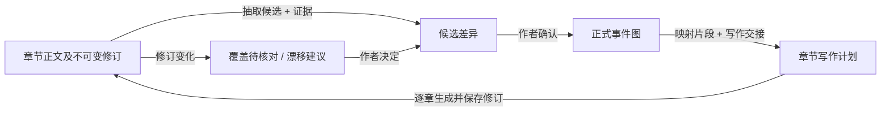

# 事件图与书籍工作区双向联动：后端详细设计

> 设计稿 · 2026-10-16 · 待实施。本文定义下一阶段的业务契约和落地顺序，不表示相关接口已经完成。
>
> 适用于当前**一张事件图、底部阶段括号、可拖动节点、右侧 Markdown 信息文档**的界面。事件图是故事计划的权威来源；章节修订是正文的权威来源。两者通过章节映射和可核对的写作交接连接。
>
> 本文更新了[既有产品设计](./event-graph-long-novel-design.md)中“一个叶子只属于一章”“事件图不能直接发起正文生成”的结论。节点与关系语义仍参考[理论设计](./event-graph-theory-and-node-design.md)。
> 具体实施任务按[模块实施设计](./event-graph-modules/README.md)执行。
> 当前书库内容均为可删除的测试数据；本期直接清理测试书库并按新 schema 重建，不设计旧数据迁移、备份或兼容读取。

## 1. 目标与关键决定

| 目标 | 设计决定 | 完成时作者能看到什么 |
|---|---|---|
| 已有正文补入事件图 | 从当前章节修订提取**候选**事件、关系和章节映射；逐项与现有图匹配，作者确认后才写入正式图 | “第 3 章有 2 个尚未进入主线的关键变化”，可查看正文证据和候选差异 |
| AI 局部规划 | 一个事件图 Agent，以全书、阶段、节点、关系或指定字段为范围，统一输出可预览的 patch | 点中“冲突”就完善冲突；点中两个节点就规划连接；不用填写复杂表单 |
| 专属叙事理论 Skill | 沿用 `skills/event-graph/SKILL.md`，只由这个 Agent 规划图；业务校验留在应用层 | 同一套理论和字段规则服务所有范围，不出现多个互相竞争的规划 Agent |
| 事件图指导写作 | 按章节与本次选中映射生成有版本约束的交接材料，供既有写作链路使用 | 书籍工作区和事件图页面看到同一份“本章写到哪里” |
| 一个节点跨多章 | 一个可写事件可映射多个章节；每条映射写明**该章承载的推进片段与预期变化** | 同一事件可在第 3 章铺设、第 5 章升级、第 7 章完成；不重复要求每章写完最终结果 |
| 图上直接生成正文 | 事件图页面启动单节点或阶段范围的生成计划；后端仍逐章调用现有正文生成和修订保存 | 点击节点或阶段后在当前页预览目标章节、执行与查看进度，结果直接进入书籍工作区 |

页面仍只有一张图。坐标仅为排版，阶段归属、顺序、因果和章节映射必须由结构化数据表达。**正文与图不会自动互相覆盖**：反向提取与 AI 规划先形成候选；正文生成则必须显示即将写入哪些章节及采用续写还是改写。

## 2. 仓库现状与必须改动的契约

以下是 2026-10-16 对当前源文件的静态核对，不是已运行的桌面端验收。

| 现有事实 | 对新目标的影响 | 主要位置 |
|---|---|---|
| `OutlineSnapshot` 已有节点、五种关系、参与者、承诺和章节映射；`OutlinePatch` 支持新增/修改/移动节点和关系 | 可继续作为唯一正式图与候选提交管道；补充的不是第二套图模型 | [`outlineContracts.ts`](../../src/shared/contracts/outline/outlineContracts.ts) |
| `outline_node_chapters.node_id` 有 `UNIQUE`，`mapOutlineNodes` 也拒绝节点进入另一章 | 必须同时改数据库约束、业务校验、请求语义及测试 | [`outlineSchema.ts`](../../src/main/story/storage/book/outlineSchema.ts)、[`OutlineApplication.ts`](../../src/main/story/application/outline/OutlineApplication.ts) |
| 当前交接按章节选中“已确认叶子”，把节点的最终 `goal/conflict/outcome` 全量写入硬约束 | 跨章节点会在每章被要求重复完成；交接必须读取映射上的本章片段 | [`OutlineContextBuilder.ts`](../../src/main/story/application/outline/OutlineContextBuilder.ts) |
| `startChapterWriting` 只处理一个目标章节；`ChapterGenerationService` 以 `append/rewrite` 生成、保存 Tiptap 章节修订并发进度事件 | 图上批量生成应编排多个单章任务，不再建正文存储 | [`OutlineApplication.ts`](../../src/main/story/application/outline/OutlineApplication.ts)、[`ChapterGenerationService.ts`](../../src/main/story/application/books/ChapterGenerationService.ts) |
| 当前 `event-graph` Skill 规定“高层事件先拆子事件、每个叶子落一章”，写作 Agent 是 `chapter-writer` | Skill 与交接规则要按新映射语义更新；不新建第二个事件图 Agent | [`event-graph/SKILL.md`](../../skills/event-graph/SKILL.md)、[`chapter-writer/SKILL.md`](../../skills/chapter-writer/SKILL.md) |
| 前端有真实快照页面，也有单独的静态 JSON 示例；右侧 Markdown 的自由段落与关系原子保存尚未完成 | 接后端时只让真实快照驱动正式操作；静态示例继续隔离。结构字段保存必须先可往返 | [`event-graph/`](../../src/renderer/features/event-graph/) |

现有 `OutlineNode.status` 是**节点整体状态**，`ChapterOutlineMapping.coverageStatus` 是**单章覆盖状态**。跨章后不能再用某一章的完成状态直接推断整个节点已完成；参见第 5 节。

## 3. 统一业务模型

### 3.1 三种事实来源



- **事件图**：正式的故事意图。节点 ID、阶段、叙述序、人物变化、语义关系和承诺有结构化存储。右侧 Markdown 是其可读投影加作者笔记，不另立一份独立事实。
- **正文**：书籍工作区当前章节修订。生成、编辑、恢复都由书籍模块保存；事件图页面不维护第二份正文。
- **候选和证据**：AI 输出属于提案；章节文本引用必须附 `chapterId + revisionId + 文本范围/摘录`。候选在作者确认前不能参与写作指导。

### 3.2 “节点”“阶段”“叶子”的边界

阶段仍以 `arc` 及其后代表示，底部括号只投影范围。默认只有**已确认、没有子事件、达到可写粒度的节点**进入正文交接；关键事件本身如果已足够具体，就是叶子。一个叶子可以跨多章；“跨章”本身**不再是强制拆分理由**。只有它包含数个可独立选择、独立结果或需要分别建因果关系的事件时，才建议拆子节点。

单节点生成选中这个可写节点所映射的一个或多个章节片段。阶段生成按其后代中符合条件的叶子展开，阶段本身不直接变成一段正文。章可以承载多个节点，因此从数据库关系看是**节点—章节多对多**；从作者操作看，重点是“一个节点可以对应多章”。同一 `(nodeId, chapterId)` 在第一版只有一条映射；一章内同一事件出现多次，可先通过片段描述和正文证据范围表示，暂不再拆映射行。

### 3.3 关系与双顺序

`narrativeOrder` 决定读者看到事件的先后，`storyOrder` 决定故事世界中的先后；`causes/requires/reveals/foreshadows/contrasts` 仍是需要解释依据的显式关系。节点坐标、阶段相邻、同章出现均**不自动生成因果边**。跨章同一节点的片段是同一个事件的推进，不借 `causes` 自连；章节片段顺序由章节目录顺序与映射顺序确定。

## 4. 既有正文反向补图

### 4.1 入口和范围

首次进入真实书籍事件图且存在正文时，页面给出“从已有章节补充事件”的轻提示；作者也可按全书、卷或章节手动发起。默认读取**当前正式章节修订**，不把本地未保存草稿当已发表事实。若确需纳入草稿，先提示保存为章节修订。无正文的章节不进入提取。

### 4.2 处理流水线

1. **读取**：从书籍模块读取所属书的章节顺序、`currentRevisionId`、纯文本与必要的前后章上下文；记录本次输入修订清单。长章分段提取，再做章内合并，不能只截取开头。
2. **提取候选**：识别足以改变后续选择的行动、揭示或状态变化；为每项提供标题、摘要、目标、阻力、结果、参与者、故事/讲述顺序建议和**可定位的正文证据**。未能从正文确认的时间、动机、关系只标“待作者补充”，不虚构为事实。
3. **对齐现有图**：按人物、事件结果、时序和证据，给候选标记 `matched`（补映射/证据即可）、`update-suggested`（已有节点信息不全）、`new`（缺失事件）或 `uncertain`（需要人工判断）。同一事件跨章出现时合并为一个候选节点及多条章节片段；不要因章边界重复造节点。
4. **关系建议**：只有正文提供明确依据时才建议因果、前置或揭示关系。相邻段落仅能建议讲述顺序。显示“为什么建议这条边”和证据位置。
5. **审阅提交**：按章节列出候选差异；作者可忽略、修改或接受。接受时重新检查大纲修订和涉及的章节修订；有变化就重新对齐，不能用旧摘录提交。事务中提交节点/关系/映射，正文完全不变。
6. **再次运行**：按 `(chapterId, revisionId, 提取器版本)` 缓存扫描结果；正式图匹配仍按当前节点 ID/语义核对。重跑只提出新增或需更新项，不重复创建已接受节点。

对齐分数只决定排序，不自动入图。正文可能包含作者有意写出的谎言、回忆、误导或人物猜测；“正文出现”不等于“故事世界的事实已被证实”。候选必须标明陈述视角与不确定性。首版若缺独立“人物相信/读者知道”结构，可在 `summary/notes` 和 `reveals` 的说明中明示，不能把猜测写入确定的 `outcome`。

### 4.3 候选结果结构

```ts
type BackfillCandidate = {
  candidateId: string;
  disposition: "matched" | "update-suggested" | "new" | "uncertain";
  matchedNodeId?: string;
  proposedOperations: OutlinePatchOperation[];
  proposedMappings: ChapterEventMappingInput[];
  evidence: Array<{
    chapterId: string;
    revisionId: string;
    startOffset: number;
    endOffset: number;
    excerpt: string;
  }>;
  explanation: string;
};
```

这是**新提案契约示意**，不是当前已存在的 TypeScript 类型。`startOffset/endOffset` 基于该修订的规范化纯文本，打开旧证据时必须按 `revisionId` 读取，不拿当前文本的同一偏移冒充原证据。章修订变化后，证据标记为过期并重新定位或重新抽取。

## 5. 节点到多章节的映射

### 5.1 映射记录

现有映射字段保留，同时建议新增下面的**章节局部写作语义**。字段名在实现前可与现有命名统一，但含义不可省略。

```ts
type ChapterEventMapping = {
  nodeId: string;
  chapterId: string;           // 与 nodeId 组成唯一键
  sortOrder: number;           // 本章多个节点的写作顺序
  segmentIntent: string;       // 本章写这个事件的哪一段、角色和边界
  expectedLocalChange: string; // 本章结束时必须产生的局部变化
  coverageStatus: "planned" | "drafted" | "verified" | "deviated";
  coverageNote: string;
  verificationOutlineRevision: number | null;
  verificationChapterRevisionId: string | null;
};
```

例：节点“同伴身份暴露”的全局 `outcome` 是“主角确认同伴参与掩盖”。它可映射：第 3 章“看到矛盾证词，只产生怀疑”；第 5 章“找到伪造记录，怀疑升级”；第 7 章“当面对质，确认事实”。前两章的交接只要求局部变化，不得提前写出第 7 章结果。建议 UI 给出“铺设／推进／完成”快捷措辞，但底层以可读的 `segmentIntent` 和 `expectedLocalChange` 为准，避免一组标签代替写作边界。

数据库新 schema 将 `outline_node_chapters.node_id UNIQUE` 去掉，保留 `PRIMARY KEY(chapter_id,node_id)`，增加 `INDEX(node_id, chapter_id)`。实施时更新建表定义和书库 schema 版本，清理现有**测试书库**后重新创建，只验证新建库的结构与行为；具体步骤见[模块 01](./event-graph-modules/01-data-and-mapping.md)。

### 5.2 写作与覆盖状态

- 一条映射的覆盖结果只对 `(nodeId, chapterId, chapterRevisionId, 有关叙事内容修订)` 有效。作者改了该章正文，这条映射转为待复核；其他章的有效结果不应被误清除。
- AI 生成成功后，**实际写入该章的映射**进入待核对/`drafted`；不能因为请求里包含一个节点，就把它在其他章节的映射也标为已写。
- 节点整体 `covered` 仅当它的所有**必需映射片段**都经作者确认 `verified` 且最终 `outcome` 已在完成片段得到证据时成立。只验证前两章不能提前让节点整体完成。若未来允许可选映射，再引入显式必需标记；首版所有已配置映射均视为必需。
- `needs_revision` 应表示正式图与正文有待处理的冲突；一次章节核对建议不应直接覆盖作者确认的全局节点状态。区分“AI 建议偏离”和“作者确认需要修订”。
- `unmap` 请求必须包含 `chapterId + nodeId`，不能再凭 `nodeId` 删掉全部章节映射。删除/移动节点、移动章节时给出受影响映射和覆盖证据。

### 5.3 交接构造

为目标章节选择映射时，读取节点全局意图、该章 `segmentIntent/expectedLocalChange`、先前已写片段、因果前提、人物状态、承诺和下一个事件边界。最终指令明确区分：

1. **本章必须实现**：所选映射的局部变化与该章相关的关系/伏笔要求。
2. **全局终点**：节点最终结果，仅作为方向；除非本章是完成片段，不要求此章兑现。
3. **此前已经发生**：前面章节的已确认正文与映射证据，供连贯性参考。
4. **暂不可展开**：后续章节才发生的片段和紧邻后续节点。

`EventGraphHandoff` 建议扩展为包含明确的映射键、按章局部约束、`outlineRevision`、目标章 `currentRevisionId/rowVersion`，而非只给 `nodeIds` 和大段指令。预览与执行必须比较同一份交接摘要；作者清空选择不能按现有空数组语义暗中“全选”。书籍工作区继续消费这一个交接服务。

映射输入示例（第 3 章与第 7 章指向**同一节点 ID**）：

```json
[
  {
    "nodeId": "event-reveal",
    "chapterId": "chapter-3",
    "sortOrder": 2000,
    "segmentIntent": "主角看见相互矛盾的证词，开始怀疑同伴；暂不确认其身份",
    "expectedLocalChange": "主角从完全信任转为私下求证"
  },
  {
    "nodeId": "event-reveal",
    "chapterId": "chapter-7",
    "sortOrder": 1000,
    "segmentIntent": "主角拿证据当面对质，完成身份揭示",
    "expectedLocalChange": "主角确认同伴参与掩盖，并决定公开证据"
  }
]
```

## 6. 单个事件图 Agent 与 AI 规划

### 6.1 Agent 的职责

保留一个运行时 `event-graph` Agent 与一个叙事理论 Skill。Skill 说明事件粒度、因果/前置/揭示/伏笔区别、人物意图与状态变化、故事序/讲述序、跨章片段，以及“证据不足时保持待定”。`src/main/story/` 负责授权范围、读取书籍数据、校验、预览、提交；通用 `src/main/agent/` 不接收书籍业务逻辑。

当前 Skill 的“跨章先拆子事件、每个叶子只落一章”需要更新；“AI 候选不直接改正文”和“作者接受前不提交 patch”仍保留。正文反向抽取可以复用同一个事件图 Agent 的理论与提案格式，通过应用服务提供只读章节证据；不再增加“正文转事件图 Agent”。正文生成使用现有章节写作链路，事件图 Agent 不写小说正文。

### 6.2 一个范围契约覆盖五种规划

```ts
type PlanningScope =
  | { kind: "book" }
  | { kind: "stage"; stageNodeId: string }
  | { kind: "node"; nodeId: string }
  | { kind: "relation"; sourceNodeId: string; targetNodeId: string }
  | { kind: "field"; nodeId: string; field: "title" | "summary" | "goal" |
      "conflict" | "outcome" | "locationText" | "timeText" |
      "structuralRole" | "narrativeFunction" | "notes" };

type PlanEventGraphRequest = {
  projectId: string;
  scope: PlanningScope;
  instruction?: string; // 一句可选补充要求
  expectedOutlineRevision: number;
};
```

范围由界面选中对象自动带入，作者通常只需点“让 AI 完善”并可选写一句要求。全书默认建议下一层关键事件；阶段默认建议补缺少的推进节点；节点默认完善内容和直接关系；两节点默认只规划它们之间的连接；字段默认只改该属性。`planningMode`（顺序/高潮优先）可保留为高级选项，不要求用户先理解术语。

**范围约束由后端校验，而非仅靠提示词：** `field` 只能产生该节点该字段的更新；`relation` 只能触及指定的两节点及其连接；`node` 只能触及该节点、其允许的新子节点和直接关系；`stage` 只能触及该阶段的子树及其被明确批准的外部连接；`book` 才允许全书提案。参与者这类非简单属性在专用子范围操作中修改，避免借 `participants` 数组全量覆盖其他作者数据。若模型返回越界操作，给出可修复问题，绝不偷偷裁切后提交。

### 6.3 候选、预览、接受

所有范围沿用 `OutlinePatch` 的 `expectedRevision`、`simulateOutlinePatch` 和作者确认后的 `applyOutlinePatch`。建议扩充候选包，除 patch 外还包含原因、受影响节点/章节/承诺、校验问题与来源证据。字段级预览展示“旧值 → 新值”；关系预览展示边类型、方向、说明和为何不等同于叙述顺序；节点预览展示新增/改动/删除。候选撤销只丢弃提案，不改正式图。

接受前再次校验大纲修订、目标对象存在、字段允许修改、跨阶段关系语义、章节映射不被破坏。一个候选中有节点和映射联动时，用**同一次事务**提交，不能图已改而映射写失败。大纲修订冲突时保留候选供重算或人工调整，不直接覆盖。

## 7. 从事件图页面直接生成正文

### 7.1 操作入口与预览

- **单节点**：选中可写叶子，点击“生成正文”；默认勾选它尚未写完的映射章节，作者可改为只生成指定章/连续片段。
- **阶段**：点击底部阶段括号，选择“按本阶段生成正文”；展开为该阶段已确认的可写叶子，并按讲述顺序与章节安排组成多章计划。默认先展示范围、节点数、章节数、预计调用次数和现有正文状态。
- **准备条件**：所选节点必须已确认并有合法章节映射及非空的本章片段要求；缺失时展示可补的映射清单，不暗中创建章节或放弃主线。已有正文默认“续写”，改写必须明确选章并单独确认影响；不把一整阶段一次性生成成无法定位的长文本。

预览中的**实际执行单位是章节**。一章可包含多个选中节点；同一节点跨多章则在各章使用不同局部片段。对未被选中的同章事件，只送入边界上下文，不要求本次展开。计划按目录章节顺序执行；章内按映射 `sortOrder`、节点 `narrativeOrder` 排序。故事时间顺序单独注明，不被目录顺序覆盖。

### 7.2 计划契约与执行

```ts
type GraphWritingPlan = {
  planId: string;
  scope: { kind: "node" | "stage"; id: string };
  outlineRevision: number;
  steps: Array<{
    chapterId: string;
    expectedChapterRevisionId: string | null;
    expectedChapterRowVersion: number;
    mappings: Array<{ nodeId: string; chapterId: string }>;
    mode: "append" | "rewrite";
    handoffDigest: string;
  }>;
};
```

`previewGraphWritingPlan` 构建每章交接、预算和冲突；`startGraphWritingPlan` 只接受作者刚确认的 `planId/摘要`，执行前核对当前图、章节修订和映射。后端在 `src/main/story/application/` 设一个图上写作编排用例，复用 `OutlineApplication` 的交接与 `ChapterGenerationService.generate` 的保存/进度；不让 renderer 循环调用 `startChapterWriting`，也不把业务编排放进通用 Agent 引擎。

批量阶段采用**串行逐章**：每章成功保存修订后，下一章读取刚更新的前文和当前章节修订。每一步生成前重新验证该步目标章及图的**叙事内容**没有被外部修改；本计划自身的覆盖状态更新不应使剩余步骤误判为冲突。单章已有写作任务时加锁或拒绝并发。单章生成成功即保留该章修订；后续失败不回滚已写章节，而是明确展示“已完成/未开始/失败”，重试只运行剩余步骤并重新预览其上下文。取消停止未开始和正在流式生成的步骤，不删除已保存修订。

每章生成仍经过 `ChapterGenerationService` 的乐观并发保存：章节当前修订、行版本与预览不一致时暂停该章，不覆盖作者在书籍工作区的新修改。阶段过大或交接超预算时，在预览阶段按章拆小并限制最大章节/节点数；不能默默截掉硬约束。模型流式进度按 `planId + chapterId + generationId` 关联，恢复页面时可重新读取计划状态。方案至少保存计划状态与步骤结果的元数据，避免窗口关闭后只有正文修订、没有批量执行结果；保存的正文依旧只在书籍模块。

### 7.3 写后状态与页面反馈

每章成功后写入章节修订，相关**映射**标为待核对，记录 `chapterRevisionId`；失败步骤不标已写。页面显示生成进度、修订入口和“到书籍工作区修改正文”。AI 覆盖核对只给证据与建议；作者确认后映射变为 `verified`。手工编辑正文后，相关证据和覆盖结论变为待复核；若关键结果改变，事件图给出“更新图的候选 / 回正文修正 / 保留有意偏离”，不自动改任一侧。

## 8. 界面与 Markdown 文档的接入

| 位置 | 新增交互 | 数据边界 |
|---|---|---|
| 单画布顶部 | “从已有正文补图”“规划主线” | 真实书籍数据；静态 JSON 入口继续只作演示 |
| 选中节点右侧 Markdown 文档 | 文档内展示目标、阻力、结果、直接关系、跨章片段与覆盖证据；每个结构字段有“AI 完善”入口 | 固定段落来自正式结构数据；作者笔记保留自由文本。改字段不覆盖其他字段 |
| 选中关系 | 查看方向、类型、理由；可调用 AI 规划指定连接 | 关系以节点 ID 关联，标题变化不失效 |
| 底部阶段括号 | 查看阶段摘要、后代节点、覆盖缺口，发起本阶段正文生成 | 仍在同一张图和同一右侧面板中 |
| 生成预览/进度 | 章节清单、每章片段要求、续写/改写、版本、预算、结果 | 正文落入原章节修订；页内只显示任务状态与跳转 |
| 书籍工作区 | 展示同一章的图上指导和多节点映射，支持跳回图 | 不复制一份可独立编辑的主线 |

Markdown 信息文档中结构化段落的保存应走解析、字段级校验和原子业务变更。关系链接使用稳定节点 ID；自由笔记独立保存。解析失败保留原文并指出位置。实现反向补图与字段规划前，先确保页面读写现有节点字段不会吞掉目标、冲突、结果、时间、地点或关系。

## 9. API、存储与边界建议

### 9.1 应用用例及 IPC

| 用例 | 输入要点 | 输出 | 写入时机 |
|---|---|---|---|
| `scanChaptersForEventGraph` | `projectId`、章节范围、预期修订清单 | 缺失/匹配候选与证据 | 只读，可缓存候选 |
| `previewBackfill` / `acceptBackfill` | 候选 ID、所选项、图与章节版本 | patch 差异、接受后的快照 | 仅接受时写图和映射 |
| `planEventGraph` | `PlanningScope`、可选一句要求、图版本 | `OutlineProposal` 扩展候选 | 只读/候选 |
| `previewGraphWritingPlan` | 节点或阶段 ID、选择的映射、模式 | 每章交接、冲突、预算 | 只读/计划元数据 |
| `start/cancel/getGraphWritingPlan` | `planId`、交接摘要/执行令牌 | 进度、各章修订和错误 | 逐章写章节修订及任务状态 |
| `map/unmapOutlineNodeChapter` | `(nodeId, chapterId)`、局部片段、图版本 | 更新快照 | 一次图事务 |

共享契约放 `src/shared/contracts/outline/`，IPC 在 `src/main/desktop/ipc/` 严格校验，领域用例放 `src/main/story/application/outline/` 与书籍应用协作。项目/书籍归属、节点是否同一图、章节是否属于同一本书、软删除状态、范围与 ID 数量都由后端复核；前端隐藏按钮不是授权校验。

`OutlinePatch` 目前没有章节映射操作。反向补图的接受接口需要把 `patch + mappingChanges` 作为一个复合命令交给同一个应用用例，在同一数据库事务里模拟、验证、提交；不能先调用 `applyOutlinePatch`，再逐条调用 `mapOutlineNodes`。如果把映射操作加入 `OutlinePatchOperation`，也要保证旧提案的解析与版本行为明确，不能把模型生成的原始章节 ID 直接视作已授权写入。

### 9.2 一致性与幂等

- 所有正式图提交带大纲版本；正文生成带目标章当前修订和行版本。提交候选时重新验证引用的章节证据仍是同一修订。
- 扫描与生成操作分别有 `operationId/planId`，同一请求重试不得重复创建节点或重复续写。模型调用成功但提交失败时可重试提交已记录的结果，不能盲目再次调用模型并写第二遍。
- AI 提取、提案、写作三个活动可能并发：图 patch 的原子性在图存储层保证；章节修订由书籍存储负责；跨图与章节的任务状态用可恢复步骤记录协调，不假设跨模型调用存在长事务。
- 修订“新旧”应基于叙事内容及映射版本，而非所有状态字段变动都令指导失效。覆盖确认、任务进度这类派生写入不能使同批次后续章节无故过期；作者修改节点核心字段、关系、映射片段或正文则必须触发重新预览。

### 9.3 最小持久化增量

| 数据 | 建议存储 | 目的 |
|---|---|---|
| 每章局部写作要求 | `outline_node_chapters.segment_intent`、`expected_local_change` | 构造跨章交接的硬约束，随正式图事务保存 |
| 正文证据 | 新的 `outline_mapping_evidence`，以 `(node_id, chapter_id, revision_id, start_offset, end_offset)` 定位并记录摘录/核对来源 | 复核覆盖结论、点击跳到正文；章节修订变动时可判过期 |
| 反向补图候选 | 可恢复的提案记录，包含扫描的章节修订清单、候选内容与作者选择 | 重开页面后继续审阅，避免重复提取和重复创建 |
| 图上生成任务 | `graph_writing_runs` 与 `graph_writing_steps`，记录计划摘要、每章执行状态、generationId、保存后的 revisionId、错误信息 | 窗口关闭或中途失败后恢复进度和安全重试 |

任务状态建议是 `previewed → running → completed/partial/failed/cancelled`；单章步骤是 `pending → running → saved/failed/cancelled`。只有 `saved` 才带有效章节修订 ID。任务恢复时从存储确认已保存的步骤，不根据前端进度条猜测，也不对 `saved` 步骤再次执行 `append`。证据摘录、候选正文和模型输出都属于本地书籍内容，应沿用当前项目存储和日志边界；运行日志只记录 ID、版本、时长与错误类别，避免把整章文本写入日志。

### 9.4 资料范围与提示词负担

Agent 只读取当前书与所选范围相关的章节文本、节点邻居、人物状态和承诺；长篇按章/段检索证据，在提示词预算内保留关键约束及出处，不直接塞整本书。默认提示词框架由产品提供：**当前范围 + 已确认故事事实 + 所选章节证据 + 用户可选一句要求 + 输出 schema + 越界禁止项**。用户不需填写时间、地点、角色、关系等一大张 AI 表单；缺资料时提示可补信息，不填伪默认值。

## 10. 分步实施与验收

以下顺序确保每一步交付都能独立验证，且后一步不会建立在错误映射语义上。

| 顺序 | 交付内容 | 最小验收 |
|---|---|---|
| 0. 锁定现有数据往返 | 核对真实图的结构字段、Markdown 编辑、关系和修订；修复会吞字段的投影/提交 | 改一个字段后重开，其余字段、关系和笔记不变；演示 JSON 不串入真实书 |
| 1. 跨章映射契约 | 更新新书库 schema、`ChapterOutlineMapping` 局部片段、map/unmap、读写及覆盖规则 | 新测试书库中同一节点映射两章后重启仍在；解除一章映射不影响另一章 |
| 2. 跨章写作交接 | 每章只接收该章片段，前后文和最终结果各守边界；更新书籍工作区主线条 | 同节点前章仅铺设、后章完成；前章指令不提前泄露最终结果；预览与执行一致 |
| 3. AI 范围规划 | 更新事件图 Skill、范围契约、字段/关系/节点/阶段候选校验与 UI 入口 | 字段规划只改指定字段；越界 patch 被拒；拒绝候选不变更正式图 |
| 4. 既有正文反向补图 | 章节扫描、证据、对齐、差异审阅、接受与重扫幂等 | 一章已有正文能提出新事件；两章同一事件合并；旧修订证据被标过期；接受后正文不变 |
| 5. 单节点图上生成 | 预览节点映射章节并由页面直接启动，复用单章服务 | 单章与跨两章都落入对应章节修订；失败不标覆盖；已有正文冲突不覆盖 |
| 6. 阶段批量生成 | 后代展开、逐章编排、进度、取消、局部失败与恢复 | 一阶段多节点多章按序生成；中途失败可从剩余步骤继续；已成功章不重复续写 |
| 7. 写后闭环 | 按映射证据核对，章节修订变化提醒，偏离转为图候选 | 一个节点所有必需片段确认后才整体覆盖；正文再编辑使对应章证据待复核 |

验证优先使用受影响的 `OutlineApplication`、`OutlineContextBuilder`、`SqliteOutlineStore`、`ChapterGenerationService` 和前端模型定向测试；改动 shared/main 时跑 `npm run check:backend`，renderer 跑 `npm run lint:frontend` 与相关测试，跨层联动再跑 `npm run check`。最后用**一本已有多个正文修订的书**与**一本新书**做桌面端贯通：正文补图 → 局部规划 → 跨章映射 → 节点生成 → 阶段生成 → 人工编辑 → 覆盖复核。

## 11. 需要持续保持的产品边界

1. 只有**一张正式事件图**；不增加按人物、因果或时间切换的独立图，也不把阶段变成另一张面板式事件列表。
2. AI 提供可检验的建议，作者决定主线；正文抽取与生成结果均不能自动宣布“主线已经确认”或“已覆盖”。
3. 图负责决定**写什么、为何发生、这一章推进到哪里**；章节正文与修订仍在书籍工作区负责。图上“生成正文”是对同一写作服务的直接入口，不是第二个正文编辑器。
4. 关系、映射、证据、状态必须按稳定 ID 和修订关联；拖动坐标与 Markdown 中的标题文本不能成为业务键。
5. 同一跨章节点的每章目标由映射表达。若一个节点需要记录多个独立事件结果，建议拆节点；若只是同一事件的铺设、升级、完成，就保留单节点多章映射。
