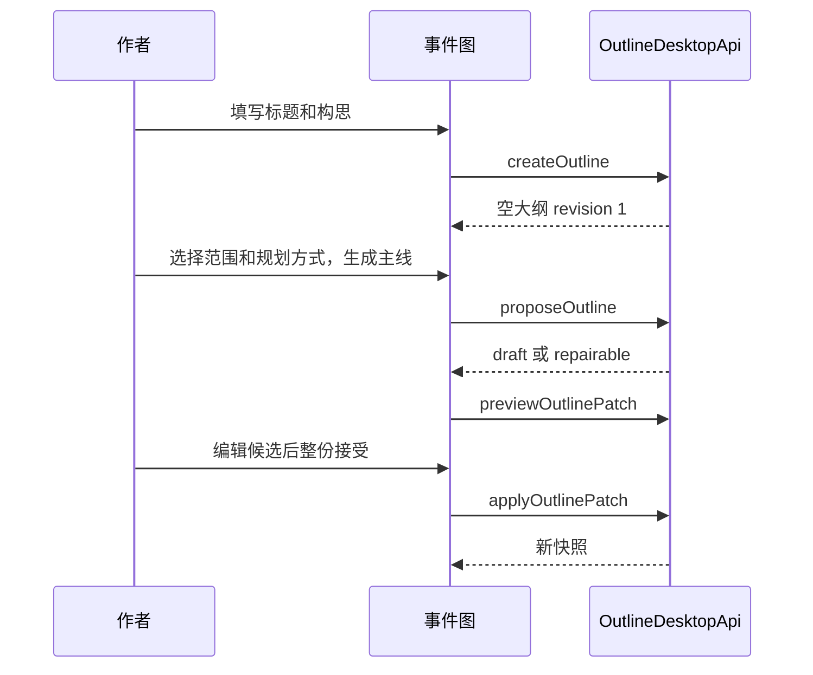

# 事件图第一版执行步骤分析

> 执行分析稿 · 2026-10-16<br>
> 依据 [事件图 AI 主线生成与书籍工作区写作联动设计](./event-graph-long-novel-design.md)。<br>
> 本文把第一版拆成可依次交付的阶段和功能。阶段 A、B 先打通「构思 → 确认主线 → 映射章节 → 在书籍工作区写作」。阶段 C 补写后核对。每一阶段都沿用已经落地的大纲契约和用例，不另建主线表、版本树或第二份章节大纲。

> 阅读顺序：A1–C4 保留第一版目标与验收口径；第 9 节是当时的执行清单，第 10 节记录后续已落实的行为。当前仍需桌面端贯通验收，以及 Markdown 全文和关系的正式持久化；不要把历史清单误读为当前待办。

## 1. 第一版做到哪里

作者能走完这条路径：

1. 打开当前书的事件图，看到空状态或这本书自己的大纲，看不到示例故事。
2. 写下标题和构思，生成一份不超过 8 个关键节点的候选，审阅后整份接受。重开书籍后，已接受的主线仍在。
3. 把已确认的叶子映射到某一章，在事件图和书籍工作区看到同一份本章主线。
4. 在书籍工作区手写，或确认交接后让 AI 续写、重写。写作器收到的指令来自当前正式快照。
5. 写完后能看出哪些计划事件还待核验；正文或大纲再改之后，旧的核验结论标为过期。

阶段 C 的「重要偏离后预览主线改动」放在 A、B 可用之后。人物知识的正式模型、多套并行主线和全书一次写完不进入第一版。画布布局已按单画布方向实现。

## 2. 代码落在哪里

事件图继续放在 `src/renderer/features/event-graph/`。书籍工作区的本章主线放在 `src/renderer/features/book-workspace/`，页面文件只做路由转交。大纲读写仍走 `OutlineDesktopApi` 和 `OutlineApplication`，不把节点、承诺或章节映射放进 `src/main/agent`。

| 已有能力 | 第一版怎么用 |
|---|---|
| `getOutlineSnapshot`、`createOutline`、`updateOutlineProfile` | 空状态创建大纲，设定面板保存前提、主题、核心冲突、高潮和结局。 |
| `proposeOutline`、`previewOutlinePatch`、`applyOutlinePatch` | 生成一份候选，预览通过后再整份接受。候选留在页面状态，接受前不写正式快照。 |
| `mapOutlineNodes`、`unmapOutlineNode`、`updateOutlineNode` | 叶子映射到真实章节；作者确认覆盖或标成需修订时更新节点状态。 |
| `loadEventGraphHandoff`、`waiveChapterMainline`、`buildChapterContext` | 两处本章主线都调用交接。超预算、缺叶子、放弃主线都显示交接返回的状态。 |
| `startChapterWriting` | 只在书籍工作区、作者确认交接之后调用。事件图不再从这里直接写正文。 |
| `markNodesPendingVerification` | 生成并保存成功后，已选叶子变为待核验。这个动作已经包在 `startChapterWriting` 的 `ready` 结果里。 |
| `reviewChapterCoverage` | 作者要求核对时给出建议和问题。它不能改节点状态，界面也不要把它的结果写成「已覆盖」。 |
| `ChapterGenerationService` 与 `generationStore` | 续写、重写的进度、重试和正文预览继续走书籍工作区现有生成事件。 |

当前工作树的 `EventGraphPage` 已读取路由里的 `projectId` 并调用 `useEventGraphSession`；会话用当前书的快照和章节构造页面，空快照走 `emptyDocument`，写作入口已移到书籍工作区。下一轮仍需用新书、已有书和读取失败三个真实场景确认这些路径，并确认测试中的 `sampleDocument()` 不会流入生产页面。

`GraphDocument` 是单画布的前端投影，不是第二份正式主线；全书设定、候选差异和本章交接分别读取 `OutlineSnapshot`、`OutlineProposal` 和 `EventGraphHandoff`。正式节点的目标、冲突、结果等字段仍以共享契约和快照为准，不从 Markdown 摘要反推。

## 3. 三阶段共用的规则

页面上同时只认五种来源，渲染时分开存放：

| 来源 | 存放 | 作者看到的含义 |
|---|---|---|
| 正式大纲快照 | 书库，经 `getOutlineSnapshot` | 已保存的设定、节点、关系、映射和修订号 |
| 未提交 AI 候选 | 页面中的 `OutlineProposal` | 可接受、拒绝、重生成或接受前编辑 |
| 界面临时想法 | 事件图现有的想法草稿 | 作者随手记的一句，还没调用模型 |
| 章节正文修订 | 现有章节修订 | 书籍工作区正在写的文字 |
| 检查建议 | `OutlineIssue` | 结构问题或覆盖建议，不自动改主线 |

节点状态继续用契约里的 `draft`、`confirmed`、`writing`、`covered`、`needs_revision`。章节主线上把 `writing` 显示为「待核验」。映射上的 `coverageStatus` 第一版保持创建时的 `planned`，作者是否确认覆盖看节点状态，以及映射上已有的 `verificationOutlineRevision`、`verificationChapterRevisionId`。不新增覆盖表，也不让 `reviewChapterCoverage` 去写状态。

修订冲突时保留候选，重新读取快照，并列出候选上的 `expectedRevision` 和快照上的当前修订。作者重新生成或放弃候选。接受请求不得自动改基线后再提交。

读取失败时显示错误和重试。快照为 `null` 时显示空状态。两条路径都不调用 `sampleDocument()`。示例故事只留在现有模型测试里；若开发时需要看样例，使用独立入口并在页面上标明这不是当前书籍。

## 4. 阶段 A：真实主线与 AI 候选

阶段目标：作者从自己的构思生成并保存一份不超过 8 个关键节点的全书骨架，重开后仍在。此阶段不映射章节，也不进入写作。



### A1. 页面接上当前书籍

事件图路由已经是 `/projects/:projectId/events`。页面从路由读取 `projectId`，用它调用会话，不再在组件内用固定样例启动。

改动集中在：

- `src/renderer/features/event-graph/EventGraphPage.tsx`
- `src/renderer/features/event-graph/useEventGraphSession.ts`

会话加载时并行读取 `getOutlineSnapshot(projectId)` 和 `getBookWorkspace(projectId)`。工作区状态为 `ready` 时，用书名和真实章节列表；章节筛选只显示这本书的章节。快照存在时，轨道使用 `documentFromSnapshot`。快照为 `null` 时进入 A2 的空状态，轨道不渲染节点。读取抛错时保留空状态和错误说明，提供重试。

完成时：

- 有大纲的书打开后看到自己的节点和修订号。
- 没有大纲的书看不到「沈衡与梁秋」或任何示例章节。
- 接口失败时页面上是错误，不是另一本故事。

### A2. 全书设定

空状态要求作者先建立大纲。标题默认取工作区书名，作者可以改；构思写入 `premise`，必填。主题、核心冲突、高潮和结局可以留空。空字段在设定面板显示「待定」。

建立时调用 `createOutline`。请求里的空字段传空字符串，因为现有契约允许这些字段为空。不在建立时附带 `rootTitle`，避免出现一个作者没确认的根节点。建立成功后正式快照只有设定、没有事件。放弃后来的候选不会删除这个大纲。

已有大纲时，顶部提供可折叠设定。保存调用 `updateOutlineProfile`，带上当前 `expectedRevision`。设定不放进 `OutlinePatch`，模型候选也不能改这六个字段。保存冲突时重新读取快照，保留作者刚输入的内容，请作者再次保存。

`GraphDocument` 继续负责轨道。设定面板直接绑定快照里的 `outline`，避免把前提和主题塞进节点摘要。

完成时：

- 只填标题和构思就能建立大纲。
- 空的主题、高潮、结局显示「待定」。
- 重新打开后设定仍在，事件数仍是 0。

### A3. 生成主线

主操作是「生成主线」，和底部「输入一个想法」分开。生成前作者选择：

| 控件 | 传给 `proposeOutline` |
|---|---|
| 顺序规划或高潮优先 | `planningMode`: `sequential` 或 `climax-first` |
| 范围是全书 | `parentNodeId: null`，`focusNodeIds` 为空或为当前明确点名的节点 |
| 范围是一个故事弧或节点 | `parentNodeId` 为该节点，表示只展开它的下一层 |
| 补充要求 | `instruction`，可空 |

没有大纲时，「生成主线」不可用，先完成 A2。已有大纲时才调用 `proposeOutline`。这样候选上的 `outlineId` 和 `expectedRevision` 来自正式快照，接受时和 `applyOutlinePatch` 的前提一致。

模型返回 `repairable` 时，正式轨道不变，侧栏列出 `problems`。作者改要求后重试。返回 `draft` 后先调用 `previewOutlinePatch`；预览失败同样留在问题列表，不把操作画到正式节点上。

生成中显示范围和规划方式。正式节点保持上一次成功的快照。

完成时：

- 一次候选最多新增 8 个节点，且只展开选定范围的一层。提示词里已有这条规则，界面按返回结果展示，不在客户端截断多余节点再当成完整结果。
- 未点名的已有节点不出现在候选的 `update_node` 里。若出现，预览阶段把它列为问题，不自动接受。
- 无效候选可以改要求后重试。

### A4. 审阅并确认候选

候选使用独立外观，叠在正式轨道上，侧栏按操作列出差异。差异从 `proposal.patch.operations` 和当前快照比较得出，放在事件图模型的纯函数里，并配测试：

- `create_node`：新增。展示标题、目标、冲突、结果。
- `update_node`：被修改。并列当前值和候选值。
- `upsert_relation`、`delete_relation`：新关系或删除的关系。
- `upsert_promise`：新承诺或承诺变化。
- 被修改节点若已有章节映射，列入预计影响的章节。

第一版的决定是整份接受、拒绝、重新生成，以及接受前编辑候选。编辑只改页面里的这份 `OutlinePatch`，不写书库。不提供逐条勾选；勾选会拆开一批操作的依赖，留到真实使用后有需求再做。

接受调用 `applyOutlinePatch`。成功后用返回快照替换正式文档，并清掉候选。拒绝只清掉页面中的候选。重新生成用同一范围再请求一次，替换页面中的候选。

接受时若服务端返回 `OutlineRevisionConflict`，不重试提交。重新读取快照，保留候选，展示两个修订号。作者可以选择按新快照重新生成，或放弃候选。

完成时：

- 接受前写作交接看不到这些节点。
- 拒绝或关闭页面后，正式节点数不变。
- 另一处保存把修订号抬高后，旧候选不能盖掉新快照。

### A5. 想法草稿

底部输入框保持现在的本地草稿：一句想法、留下或放弃，不调用 `proposeOutline`。作者留下草稿时，若大纲已存在，用一条 `create_node` 写入，状态为 `draft`，父节点沿用当前选择。若大纲还不存在，输入框提示先建立全书设定，不偷偷创建大纲。

草稿节点可以以后被作者确认，或被 A3 的范围展开引用。它不进入章节交接。交接只收已确认、已映射、且是叶子的节点，这条已经由 `chosenChapterLeaves` 保证。

完成时：作者能分清「记下想法」和「生成主线」。想法不会变成已确认节点，也不会触发写作。

### 阶段 A 的验收

对应设计稿的前两个场景。

1. 新书打开是空状态。作者输入构思、生成候选、改一处结果后接受。取消另一份候选时，正式节点不增加。重新进入 `/projects/:projectId/events` 仍能看到已接受的骨架。
2. 选中一条故事弧生成下一层。候选只含该父节点下的一层；未点名节点的标题和结果不变。故意要一份无效候选时，轨道不变，侧栏有问题说明。

此阶段的定向检查：事件图模型测试，加上 `npm run lint:frontend` 中与这些文件相关的部分。不改主进程时不跑后端全量检查。

## 5. 阶段 B：章节映射与写作交接

阶段目标：作者把已确认叶子交给一章，在事件图和书籍工作区看到同一份预览，并在书籍工作区完成手写或 AI 写作。写作器收到的指令是该章正式快照的派生产物。

依赖阶段 A 的正式快照。没有已确认叶子时，本章主线说明缺什么，并给出回到对应节点的路径。

### B1. 展开范围并把叶子映射到章

「展开选中范围」复用 A3 的生成和 A4 的确认，父节点是当前故事弧或事件。确认后的节点若还有子节点，它不是叶子，不能映射。

「为章节安排事件」只对叶子可用。章节来自 `getBookWorkspace` 的真实章节，不再使用 `SAMPLE_CHAPTERS`。映射调用 `mapOutlineNodes`，一次可以把同一章的多个叶子一起映射。一个叶子已有别的章节时，现有用例会拒绝重复映射；界面先说明它属于哪一章，再让作者取消原映射后重选。取消映射调用 `unmapOutlineNode`。

跨章事件不在一个叶子上挂两章。作者把它收成父节点，再把子事件分别映射。删除节点、改父节点或改叙述顺序前，侧栏列出受影响的章节映射、指向它的关系，以及把它当作铺垫、触发或兑现的承诺。确认后才提交对应的 `applyOutlinePatch`。

事件图的章节筛选显示「这一章要完成的变化」：该章叶子的目标、冲突和结果。这里不打开正文编辑器。

完成时：

- 两个已确认叶子可以映射到第 1 章。
- 把其中一个改到第 2 章时，第 1 章不再包含它。
- 父节点和未确认草稿不能被选进章节。

### B2. 事件图里的本章主线

选中章节后提供「查看本章主线」。预览是一个对话框，使用现有 `AnimatedDialog`。内容全部来自一次 `loadEventGraphHandoff`，节点详情来自同一次快照，不另存一份「章节主线」。

作者勾选本次要写的叶子。选择变化后重新请求交接，因为指令由 `OutlineContextBuilder` 按选择生成。预览固定四块：

1. 选中的已确认叶子，各自的目标、冲突、结果。
2. 这些叶子的直接因果前提、参与者的事件前状态、本章可以兑现的承诺。
3. 叙述顺序上的下一叶子，标明只用于过渡。
4. 当前大纲修订号、将送入写作器的 `instruction`，以及交接状态。

`ready` 时显示「前往书籍工作区」。`missing` 时写明是没有大纲还是没有已确认叶子，并链到设定或对应节点。`too-large` 时说明硬约束超过预算，作者减少本次叶子后重新预览。`waived` 时明确写「本次没有事件图指导」，不把正文说成按主线写成。

从这里前往书籍工作区使用：

```text
/projects/:projectId/book?chapter=:chapterId
```

书籍工作区进入时读取 `chapter`，选中这一章。事件图从工作区返回时使用：

```text
/projects/:projectId/events?chapter=:chapterId&node=:nodeId
```

两个查询只负责打开对应章节和节点。大纲内容仍从快照读取。

完成时：同一章、同一组叶子，在事件图预览里看到的修订号和指令，与直接调用 `loadEventGraphHandoff` 的结果一致。

### B3. 书籍工作区里的本章主线

在当前章节标题旁增加可收起的「本章主线」。建议放在 `ChapterEditorPanel` 附近的新组件里，例如 `src/renderer/features/book-workspace/mainline/`。它不进入目录树，也不进助手对话。

收起时显示已确认叶子数量、待核验数量和覆盖是否过期。展开时列出叶子的目标、冲突、结果，以及本次写作范围。点击叶子跳到 B2 的事件图地址。没有大纲或没有叶子时，条上写明状态，并提供「先去事件图」。

手写时作者可以一直看着这条例。它不占据正文编辑区，也不把人物、地点、承诺的全部字段铺开。数据在章节切换和大纲修订变化时重新读取 `getOutlineSnapshot` 与 `loadEventGraphHandoff`。页面不缓存一份可编辑副本。

完成时：工作区改章节后，主线条跟着变；事件图里接受新候选后，回到工作区能看到新修订号。

### B4. 确认交接后再写作

AI 写作的按钮放在书籍工作区，不放回事件图。`useEventGraphSession` 里的 `writeProse` 从页面流程中退出，避免图上直接 `startChapterWriting`。

作者选择续写或重写后，先打开与 B2 相同的交接预览。确认后调用：

```ts
startChapterWriting({
  projectId,
  chapterId,
  selection,
  mode, // "append" | "rewrite"
})
```

这里不传 `decision: "generate-events"`。缺主线时不在写作按钮里偷偷提议一份大纲。

`written` 之后，进度、失败和重试沿用 `generationStore` 已有的章节生成事件；正文保存沿用工作区现有修订。成功时服务端已把对应叶子标为 `writing`，并记下当时的大纲修订和章节修订。界面把这些叶子显示为待核验。生成失败或保存失败时，不把叶子显示成已覆盖，事件图保留上一份成功快照，正文保留上一份成功修订。

手写不调用 `startChapterWriting`。作者保存正文后，这些叶子仍保持原状态，直到作者在阶段 C 要求核对。

完成时：

- 写作请求里的 `instruction` 等于预览中的指令。
- 下一叶子只出现在过渡说明里，不在「本章必须完成」的列表中。
- 写完后作者留在书籍工作区改对白和描写，不必回事件图找刚生成的正文。

### B5. 没有主线，或主线放不进预算

交接为 `missing` 时，预览给出两个动作：「先去事件图」和「仍然写作」。后者调用 `waiveChapterMainline`，再以 `decision: "continue"` 调用 `startChapterWriting`。放弃只对当前大纲修订有效；大纲修订变化后，下一次交接回到 `missing`，需要作者重新选择。

交接为 `too-large` 时不调用写作。预览列出本次选中的叶子，作者取消一部分后再计算。客户端不截断 `instruction`，也不把截断后的文本送进写作器。

完成时：放弃主线写成的章节，主线条写明本次没有事件图指导。超预算时正文不被生成。

### 阶段 B 的验收

对应设计稿「写第一章」。

1. 两个已确认叶子映射到第 1 章。事件图预览能看到它们的目标、冲突、结果和下一叶子的过渡边界。
2. 从预览进入书籍工作区，第 1 章被选中。主线条和预览使用同一修订号。
3. 选择续写并确认后，生成指令包含这两个叶子，不把下一叶子列为本章必须完成的事件。
4. 删除其中一个叶子的映射后，再次预览只剩一个叶子。
5. 没有叶子时选择「仍然写作」，正文可以生成，界面不把它标成受事件图指导。

定向检查：交接预览的纯函数或组件测试；映射相关交互若抽成模型函数，一并测试。后端交接行为已有 `outlineHandoff.test.ts`，本阶段不改用例时不必重跑全量后端。

## 6. 阶段 C：写后核对

阶段目标：作者能判断本章关键变化有没有写到，并决定正文偏离要不要影响后续主线。对白、描写和局部场景的修改留在书籍工作区，不提示回事件图。

依赖阶段 B 已经把叶子标成待核验，或作者手写后主动要求核对。

### C1. 待核验

AI 写作成功后，叶子状态已是 `writing`，映射上记着生成当时的大纲修订和章节修订。正文页的主线条把它们显示为待核验，不显示为已覆盖。

手写保存不会自动进入待核验。作者点击「核对本节事件」后，才对当前选中的已确认叶子调用 `markNodesPendingVerification`。请求使用当前大纲修订和当前章节修订。修订已经变了就停止，并提示先重新读取。

每个待核验叶子可以跳回事件图节点。正文里的证据位置使用检查结果已经写明的片段；问题消息里没有可定位片段时，只显示建议，不伪造高亮。

### C2. 覆盖建议与作者确认

「核对本节事件」在作者要求时调用 `reviewChapterCoverage`。返回的 `OutlineIssue` 按节点分组，显示规则、消息和来源是规则还是 AI。这些是建议。

作者对每个待核验叶子单独做决定：

| 作者决定 | 调用 | 之后的状态 |
|---|---|---|
| 确认已经写到 | `updateOutlineNode`，`status: "covered"` | 已覆盖 |
| 关键结果没写到或写反了 | `updateOutlineNode`，`status: "needs_revision"` | 需修订 |
| 先改正文 | 不改大纲 | 保持待核验 |

确认前检查映射上的两个核验修订仍等于当前大纲修订和当前章节修订。不一致时不提交状态更新，走 C3。

`reviewChapterCoverage` 已保证不改节点状态。界面在它返回后重新读取快照；若发现状态被改动，把这次核对视为失败并保留原状态。

### C3. 结论过期

下列任一变化都让旧结论过期：

- 大纲 `revision` 不等于映射上的 `verificationOutlineRevision`。
- 章节当前修订不等于 `verificationChapterRevisionId`。
- 问题自己的 `stale` 已为真，或 `checkedRevision` 落后于当前大纲修订。

过期的叶子不再显示「已覆盖」或「需修订」作为当前结论，改为「需要重新核对」。作者重新执行 C2 后，才更新节点状态。正文编辑器的普通保存一旦产生新修订，就触发这个变化；不需要事件图监听每一个字。

完成时：把已核验章节再改一段对白并保存，主线条从「已覆盖」变为「需要重新核对」。

### C4. 重要偏离回到事件图

只有建议或作者判断涉及关键事件结果、人物状态、因果前提或承诺兑现时，主线条给出「查看对后续主线的影响」。入口带到事件图，带上章节和节点：

```text
/projects/:projectId/events?chapter=:chapterId&node=:nodeId
```

事件图侧栏说明受影响的后续节点、关系和承诺，这些从当前快照直接列出。作者有三个选择：

1. 改正文。留在或返回书籍工作区，大纲不动。
2. 预览主线修改。用 A3、A4 的候选流程，`instruction` 写明正文里实际发生的变化，`focusNodeIds` 包含当前叶子和直接后续。接受后正式主线才变。
3. 保留有意偏离。把该叶子标为 `needs_revision` 或保持作者确认的状态，正文修订不动。

任一选择都不调用会改写章节正文的接口。事件图上的接受只提交大纲 patch。

完成时，对应设计稿「处理偏离」：正文把「主角发现证据」写成「同伴先发现证据」后，作者能看到人物知识和后续揭示可能受影响，可以保留正文并预览一份主线候选。原正文修订仍在。

### 阶段 C 的验收

1. AI 写完第 1 章，两个叶子是待核验。作者确认其中一个已覆盖，另一个保持待核验。
2. 再改正文并保存后，已覆盖的结论变为需要重新核对。
3. 覆盖检查返回建议时，节点状态不变，直到作者点确认。
4. 从偏离入口生成的主线候选在接受前不改正式大纲，也不改当前正文。
5. 生成失败、修订冲突或正文保存失败时，界面停留在最后一次成功的状态，不显示已覆盖。

若本阶段只使用现有 `updateOutlineNode` 和 `reviewChapterCoverage`，后端测试保持原范围。新增状态判断函数时补渲染进程测试。

## 7. 第一版功能分解顺序

| 次序 | 功能 | 可以单独验收 |
|---|---|---|
| 1 | A1 真实快照与空状态 | 打开有大纲、无大纲和读取失败的书 |
| 2 | A2 全书设定 | 建立并重新打开设定 |
| 3 | A3、A4 生成与确认 | 接受、拒绝、无效候选、修订冲突 |
| 4 | A5 想法草稿 | 草稿不进入交接 |
| 5 | B1 章节映射 | 叶子进出真实章节 |
| 6 | B2、B3 两处本章主线 | 同一修订号和同一份指令 |
| 7 | B4、B5 工作区写作 | 续写、手写、放弃主线、超预算 |
| 8 | C1–C4 写后核对 | 待核验、过期、偏离后的候选 |

A、B 完成就可以给作者用纵向链路。C 不阻塞前面的写作。每一序都保持事件图和书籍工作区能编译运行，不把半截候选写进正式快照。

## 8. 第一版明确不做

- 不增加主线表、章节主线副本或候选版本树。
- 不在一次生成里返回多份正式方案，也不支持逐条勾选接受。
- 不把 `sampleDocument()` 当作读取失败或空书的结果。
- 不在事件图里启动正文生成、展示生成进度或编辑章节正文。
- 不因对白、描写和局部场景修改自动提议主线 patch。
- 不把 `coverageStatus` 做成另一套待核验状态，也不在覆盖检查里改节点状态。
- 不实现人物知识顺序的正式模型和全书一次性写完；单画布布局已进入当前前端。

关系、承诺和下一叶子的过渡约束继续由现有 `OutlineContextBuilder` 放进交接指令。第一版用这些约束写作，不等它们各自做成独立规划功能。

## 9. 按当前工作树继续执行

本节是对 A1–C4 的**实施盘点和执行门槛**。盘点只依据当前源文件静态核对；未运行桌面端完整写作流程，因此所有条目仍需通过对应场景验收。后续开发从当前实现补齐，不重建另一套事件图或章节主线。

### 9.1 已有入口与尚待验证的结果

| 阶段 | 当前工作树已有的入口 | 不能据此宣称完成的部分 |
|---|---|---|
| A：真实主线 | `EventGraphPage` 接路由和 `useEventGraphSession`；有全书设定、AI 候选、候选差异、节点编辑与草稿入口；`documentFromSnapshot` 负责投影。 | 新书建纲、无效候选、修订冲突、接受前后数据隔离和节点字段往返仍需按 A 阶段验收。 |
| B：章节写作 | 事件图有章节映射和 `ChapterHandoffDialog`；书籍工作区有 `ChapterMainlineBar`，章节 URL 可互跳，写作从工作区调用。 | 勾选范围与交接指令的一致性、预览与实际写作的一致性、生成/保存失败后的可见状态仍需按 B 阶段验收。 |
| C：写后核对 | 主线条可发起核对、展示建议并让作者确认状态；已有 `chapterMainline` 和相关测试。 | 覆盖结论的修订有效性、连续确认多个叶子、正文再编辑后的过期状态和偏离后只修改主线的流程仍需按 C 阶段验收。 |

### 9.2 当时的执行顺序与完成门槛

下表保留实施时的任务顺序，步骤 1–5 的代码结果见第 10 节。当前主要剩余桌面端人工贯通验收，以及另行设计 Markdown 全文和关系的原子保存。

| 顺序 | 先解决什么 | 涉及范围 | 通过条件 |
|---|---|---|---|
| 1 | **锁定主线数据往返。** 对照 `OutlineNode` 原字段检查图上的节点编辑、保存、重开；重点核对 `summary`、`goal`、`conflict`、`outcome`、时间、地点和参与者。当前 `documentFromSnapshot` 将部分字段折入摘要，`toCreateInput` 又给部分字段空值；应明确哪些字段可编辑，并保证编辑一项不会吞掉其他正式字段。 | `event-graph/model/document.ts`、`storyDocument.ts`、`EventGraphPage.tsx`；必要时补纯函数测试。 | 编辑目标或冲突后重开仍是原字段；只改摘要时，未编辑的目标、冲突、时间等值不变；写作交接读取到与页面一致的正式值。 |
| 2 | **验收 A 阶段闭环。** 用真实项目按 A1–A5 顺序走空书建纲、生成、预览、编辑候选、拒绝、接受和重开；逐项记录失败点后修复。 | 事件图页面、会话、候选模型；现有大纲 API。 | 正式快照仅在接受后变化；失败/无效候选不污染正式图；修订冲突保留候选且不会自动覆盖。 |
| 3 | **统一交接选择语义。** 当前交接组件允许把全部勾选清空，而 `chosenChapterLeaves` 把空数组解释为“选中本章全部已确认叶子”。决定并实现一个一致规则：建议界面把“全不选”视为不可提交，单独提供“全选”；预览和 `startChapterWriting` 都使用同一组明确的叶子 ID。 | `ChapterHandoffDialog.tsx`、`OutlineContextBuilder.ts` 的既有语义及相关测试；确需改变 API 时同步契约。 | 取消全部勾选后不会暗中按全选写作；每次选择变化都重算交接；预览显示的叶子与写作请求的叶子一致。 |
| 4 | **验收 B 阶段写作交接。** 核对同一章从事件图、书籍工作区打开时的叶子、修订号、指令与预算；提交前若大纲已变化，重新预览并让作者确认新内容。随后验证 `ready`、`missing`、`waived`、`too-large` 和生成/保存失败。 | 两处章节入口、交接组件、工作区的写作事件。 | 写作使用作者刚确认的当前交接；超预算不启动写作；无主线继续写作明确标为放弃指导；失败不显示成功或覆盖。 |
| 5 | **确定覆盖修订规则，再验收 C 阶段。** 当前 `coverageFreshness` 比较映射上的大纲修订与全局修订，而“确认已写到”通过 `updateOutlineNode` 提升全局修订。先确定“仅修改覆盖状态”不使本次及同章其他仍有效结论过期的领域规则，再检查后端提交是否需要在同一事务内更新有效映射的核验基线，或采用可区分叙事内容变化的修订依据。不能只在前端隐藏过期提示。 | `OutlineApplication`、映射持久化、`chapterMainline.ts`、`ChapterMainlineBar.tsx`；若改契约，覆盖 shared 与主进程检查。 | 两个叶子依次确认时，第一个不会因第二个的状态确认而立即过期；正文修订改变或主线内容改变后，旧结论确实过期；检查建议本身不自动改变覆盖状态。 |
| 6 | **跑贯通验收并收尾。** 依第 4、5、6 节的阶段验收，用一本新书和一本有既存大纲的书分别走完主线、映射、写作、核对；只修复阻断闭环或造成错误状态的缺口。 | 渲染进程和相关后端用例；操作记录。 | 作者能回答“本章必须改变什么、依据哪个主线修订、写完哪些叶子尚待核验”，重开后答案一致；没有示例故事串入真实书籍。 |

第 1 步与第 3 步是第 4 步写作验收的前置门槛：若正式节点字段会丢失，或者“全不选”可能写成“全选”，就不能把 B 阶段视作可交付。第 5 步是 C 阶段的前置门槛：覆盖状态和核验修订必须用同一规则解释。

### 9.3 每一步怎样验证

| 检查层级 | 最小检查 | 触发条件 |
|---|---|---|
| 纯函数 | 定向运行 `document`、`storyDocument`、`proposalDiff`、`chapterMainline` 等相关测试；补节点字段往返、空选择、连续确认与修订过期的用例。 | 修改投影、候选、交接选择或状态判断时。 |
| 前端 | `npm run lint:frontend`；涉及类型契约时运行 `npm run typecheck`。 | 修改事件图或书籍工作区后。 |
| 后端 | `npm run check:backend` 和受影响的 `outlineHandoff`、`outlineChecks` 等测试。 | 改动 `OutlineApplication`、`OutlineContextBuilder`、持久化或 shared 契约时。 |
| 手动贯通 | 新书和已有书各一条：生成并接受主线 → 映射两个叶子 → 预览 → 写作 → 核对 → 修改正文 → 重开检查。 | A/B 合并验收与 C 最终验收时。 |

验收记录至少保留项目类型、开始与结束的大纲修订、章节修订、选中叶子 ID、交接状态、实际结果和失败截图或错误文本。无需为了文档完成而做全量检查；代码改动后的检查按实际影响范围执行，并在交付时写明结果。

## 10. 本轮实施记录

本节记录按第 9.2 节顺序实施后的代码状态。第 9 节保留原执行门槛，便于后续复查。

| 步骤 | 已落实的行为 | 验证状态 |
|---|---|---|
| 1. 节点字段往返 | 正式快照的摘要不再混入目标、冲突和时间；文档更新只提交它实际负责的字段。节点侧栏可直接编辑摘要、目标、冲突、结果、地点和时间。 | 节点投影与更新字段的定向测试通过。 |
| 2. A 阶段闭环 | 新书先保存标题和故事构思；AI 可按全书或选中节点生成候选；候选支持预览、编辑、拒绝和整份接受。想法可单独保存为 `draft` 节点。模型提示词包含正式设定中的故事构思和高潮。 | 候选解析、预览与正式快照隔离有定向测试；真实桌面端操作仍需人工验收。 |
| 3. 交接选择语义 | 作者清空勾选后不能触发按“全选”写作；从事件图前往工作区时保留本次选中的叶子。 | 后端原有空数组语义保持不变；界面提交前守卫已实现。 |
| 4. B 阶段写作 | 写作请求携带已确认的交接结果；大纲修订、最终指令或叶子变化时，后端拒绝生成并要求重新预览。无主线放弃与超预算仍走原用例。 | 交接变化拒写和构思→候选→映射→写作的用例测试通过；桌面端生成进度与失败展示仍需人工验收。 |
| 5. C 阶段核对 | 确认覆盖前，后端验证大纲、章节及映射上的核验修订。仅覆盖状态更新会在同一次提交中推进仍有效映射的核验基线；正文或主线内容变化仍使旧结论过期。偏离入口列出直接后续节点与相关承诺。 | 两叶子连续确认、旧修订拒绝、内容变化过期的定向测试通过。 |
| 6. 贯通验收 | SQLite 用例覆盖从保存构思、接受 AI 候选、章节映射、确认交接、写作到核验；渲染进程生产构建通过。 | 自动化链路通过。尚未在真实桌面窗口用新书与既存大纲各走一遍，也未验收真实模型输出质量。 |
| 7. 单画布与节点文档 | 前端已显示可拖动事件、底部阶段大括号和右侧 Markdown 文档；静态 JSON 示例有独立入口。选中事件时强调正式语义关系。 | 前端 lint 与示例交互验证通过；正式 Markdown 自由段落与关系的原子保存尚未接入。 |

代码层已形成首版纵向链路。发布或对作者开放前，仍按第 4–6 节的场景在桌面端完成最后一轮人工验收，特别检查模型返回无效候选、写作保存失败、正文编辑后的过期提示和跨书切换。
